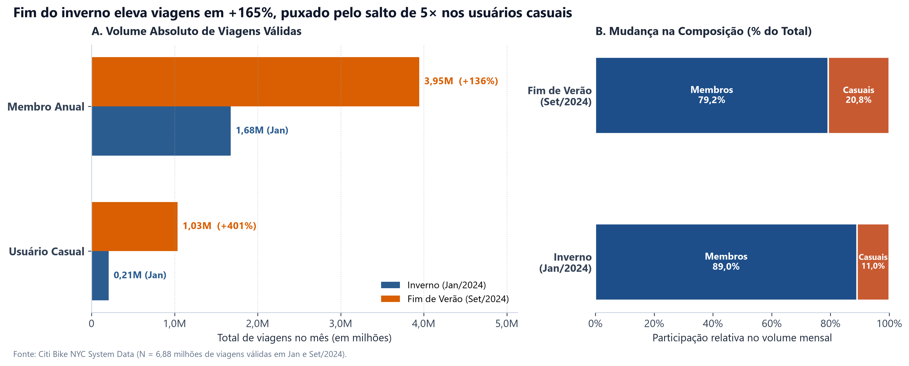
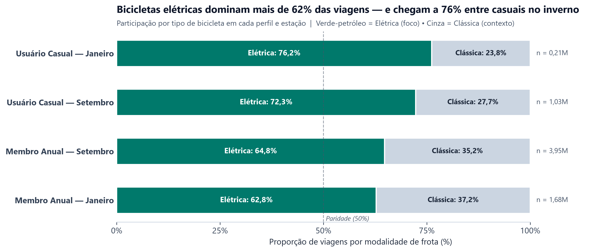
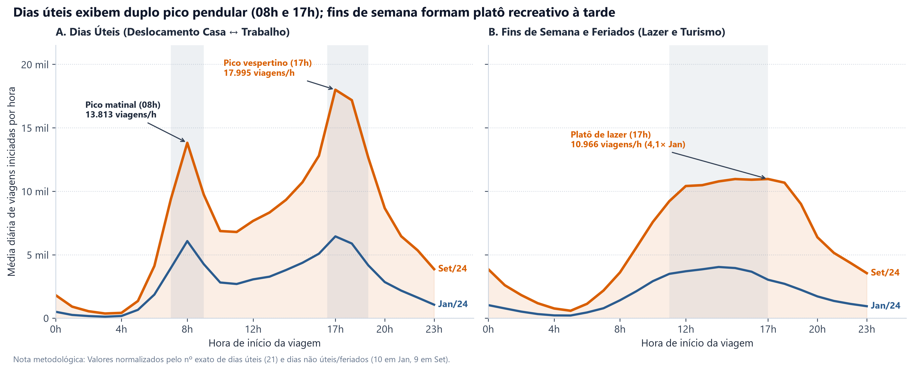
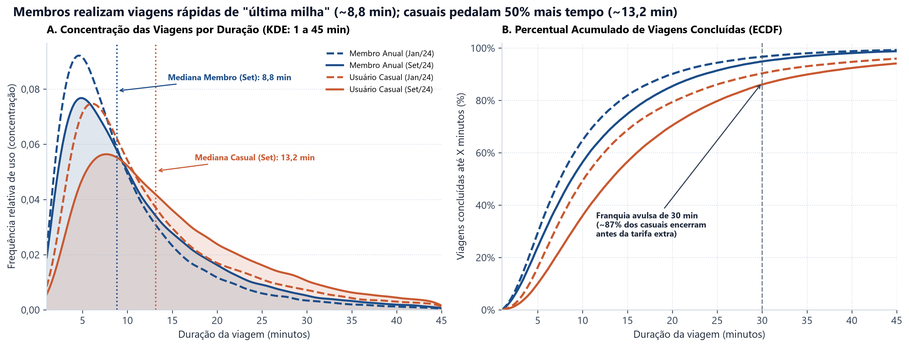
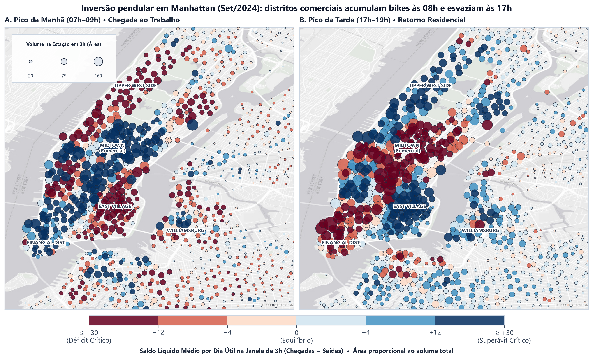

# Mobilidade Urbana e Assimetria Espaço-Temporal no Citi Bike NYC (2024)

**Disciplina:** Exploração e Visualização de Dados (ECVD — UFPB)  
**Recorte Analítico:** Janeiro/2024 (*Inverno*) vs. Setembro/2024 (*Fim de Verão*) • **6,88 milhões de viagens válidas**

---

## 1. Escopo

O **Citi Bike** é o maior sistema público de bicicletas compartilhadas da América do Norte, operando mais de 2.000 estações distribuídas por Manhattan, Brooklyn, Queens, Bronx e orla adjacente. Este projeto investiga como a transição sazonal extrema em Nova York — do **inverno rigoroso (Janeiro/2024)** ao **fim de verão ameno (Setembro/2024)** — altera estruturalmente o volume de deslocamentos, o perfil de usuários, a escolha tecnológica de frota e o equilíbrio logístico das estações ao longo do tempo e do espaço.

---

## 2. Desafio

Sistemas de micromobilidade compartilhada sofrem de **assimetria direcional crônica**: durante os horários de pico, determinadas regiões esvaziam rapidamente (**déficit** — usuários não encontram bicicletas disponíveis), enquanto centros corporativos lotam suas docas (**superávit** — usuários não conseguem devolver bicicletas). O desafio central deste estudo consiste em responder visualmente a quatro questões orientadas à tomada de decisão operacional:

1. **Elasticidade Sazonal e Perfil:** Como o clima impacta o volume absoluto e a proporção entre **Membros Anuais** (uso recorrente) e **Usuários Casuais** (uso turístico/recreativo)?
2. **Adoção Tecnológica:** Qual é o grau de preferência por **Bicicletas Elétricas** frente às **Bicicletas Clássicas**, e como ela difere entre perfis?
3. **Ritmo Circadiano:** Como a curva horária média diária distingue o fluxo pendular (*casa ↔ trabalho*) dos dias úteis em relação ao lazer de fins de semana e feriados?
4. **Dinâmica Espaço-Temporal:** Onde e quando ocorrem os gargalos críticos de esvaziamento e superlotação na malha urbana de Nova York?

---

## 3. Projeto de Visualização e Rigor Metodológico

Toda a arquitetura e engenharia visual deste repositório foi construída sob os princípios clássicos da ciência da visualização de dados (**Edward Tufte**, **Claus Wilke**, **William Cleveland & Robert McGill**, **Colin Ware** e **Scott Berinato**):

* **Integridade Estatística e Pré-processamento Estrito:**
  * Eliminação de *spillover* entre meses adjacentes (remoção de viagens iniciadas em `31/Dez/2023` ou `31/Ago/2024`), garantindo janelas mensais e semanais exatas;
  * Filtro físico de duração (`1 min ≤ duração ≤ 1.440 min`), descartando falsos desbloqueios ($<1\text{ min}$) e bicicletas extraviadas ($>24\text{h}$);
  * Barreira geográfica contra coordenadas corrompidas (*Null Island*: `40,4°N` a `41,0°N` e `74,3°W` a `73,7°W`) e projeção cartográfica métrica **Web Mercator (`EPSG:3857`)**;
  * **Normalização diária rigorosa** nas séries horárias (`viagens / nº de dias do regime`), eliminando a distorção (*Lie Factor*) causada pelo número desigual de dias úteis e fins de semana no calendário.
* **Maximização da Razão Tinta-Dados ($\text{RTD} = \frac{d-t}{T}$):**
  * Remoção de bordas superiores/direitas (*despining*), eliminação de caixas pesadas, supressão de marcadores pontuais ruidosos em séries contínuas e substituição de legendas isoladas por **rotulagem direta (*direct labeling*)** sempre que aplicável.
* **Persuasão Ética, Dêixis Visual e Redução da Cegueira à Mudança:**
  * Uso de **manchetes ativas (*active titles*)** comunicando o achado empírico principal em cada figura;
  * Apontamentos dêiticos (`annotate` com setas e faixas sombreadas `axvspan`) sinalizando picos pendulares, marcos tarifários e feriados (*Ano Novo*, *Labor Day* e *Tempestade de Inverno*);
  * Nas animações de 60 FPS, inclusão de um **painel inferior sincronizado com cursor móvel (*playhead*)**, conectando a pulsação geográfica do mapa à curva semanal da rede.

---

## 4. Mapeamento Estético (Variáveis $\rightarrow$ Canais Visuais)

Para evitar **interferência semântica pré-consciente** (quando a mesma cor representa variáveis distintas em gráficos vizinhos), cada dimensão analítica possui uma paleta dedicada e segura para daltônicos:

| Dimensão de Dados | Tipo de Variável | Canal Primário (Bertin / Cleveland) | Codificação Cromática / Visual |
| :--- | :--- | :--- | :--- |
| **Volume de Viagens** | Quantitativa contínua | Posição 2D / Comprimento alinhado (`orient='h'`, base zero) | Escala linear com marco zero obrigatório |
| **Sazonalidade (`Mês`)** | Qualitativa nominal | Matiz de cor contrastante | `#2B5C8F` (Azul Aço — Inverno/Jan) vs. `#D95F02` (Âmbar — Fim de Verão/Set) |
| **Perfil (`member_casual`)** | Qualitativa nominal | Posição agrupada + Matiz | `#1D4E89` (Azul Marinho — Membro Anual) vs. `#C85A32` (Terracota — Casual) |
| **Frota (`rideable_type`)** | Qualitativa nominal | Comprimento 100% empilhado na origem `0%` + Cor Focal vs. Cinza | `#00796B` (Verde-Petróleo — Elétrica, foco) vs. `#CBD5E1` (Cinza — Clássica, contexto) |
| **Tráfego por Estação (2h)** | Quantitativa discreta | Área de símbolo proporcional (`s = tráfego × 1,05`) | Círculos escalados estritamente pela **área** (nunca pelo raio) |
| **Saldo Logístico (`Chegadas − Saídas`)** | Quantitativa divergente | Luminância e Matiz divergente (`RdBu`) + Contorno grafite | Vermelho (`Déficit`) $\leftrightarrow$ Neutro com borda escura (`Equilíbrio`) $\leftrightarrow$ Azul (`Superávit`) |

---

## 5. Representações Visuais (RVs Estáticas e Animações 60 FPS)

### 5.1. RV 1 — Sazonalidade e Explosão do Uso Casual


### 5.2. RV 2 — Preferência Tecnológica da Frota (Elétrica vs. Clássica)


### 5.3. RV 3 — Ritmo Circadiano: Demanda Horária Média Diária


### 5.4. RV 4 — Concentração de Duração (KDE Truncada) e Percentual Acumulado (ECDF)


### 5.5. RV 5 — Assimetria Espacial Pendular: Manhã (07h–09h) vs. Tarde (17h–19h)


### 5.6. Animações Espaço-Temporais de Alta Fluidez (PCHIP • 3.360 Quadros @ 60 FPS)

Os vídeos compilados encontram-se diretamente em `ecvd_citibike/`:

* **[`ecvd_citibike/animacao_jan2024.mp4`](ecvd_citibike/animacao_jan2024.mp4)** — **Inverno (01 a 07 de Janeiro de 2024):**
  * Captura a baixa atividade do feriado de **Ano Novo (01/Jan)**, a retomada do fluxo pendular comercial entre terça e sexta-feira (`02` a `05/Jan`, picos de ~13 mil viagens/2h) e a **queda abrupta de −54% no fim de semana (`06–07/Jan`)** provocada pela primeira tempestade de neve de 2024 em Nova York.
* **[`ecvd_citibike/animacao_set2024.mp4`](ecvd_citibike/animacao_set2024.mp4)** — **Fim de Verão (01 a 07 de Setembro de 2024):**
  * Evidencia o padrão recreativo intenso no domingo (`01/Set`) e no feriado nacional de ***Labor Day* (`02/Set`)**, seguido pela explosão pendular nos dias úteis (`03` a `06/Set`), superando **40 mil viagens a cada 2 horas** com nítida inversão de cores entre manhã (Midtown azul / bairros residenciais vermelhos) e tarde (Midtown vermelho / bairros residenciais azuis).

---

## 6. Análise Empírica dos Dados

1. **Salto Sazonal Assimétrico (+165% no geral; 5,0× entre Casuais):**
   * O volume total mensal salta de **1,88 milhão** de viagens válidas em Janeiro para **4,98 milhões** em Setembro (após corte estrito de fronteira mensal e limpeza espacial/temporal).
   * Enquanto os **Membros Anuais** crescem **+136%** (`1,68M → 3,95M`) — demonstrando alta resiliência como modal de transporte cotidiano mesmo sob frio intenso —, os **Usuários Casuais** quintuplicam (**+401%**, de `206 mil` para `1,03 milhão`), elevando sua fatia no sistema de **11,0% para 20,8%**.
2. **Hegemonia das Bicicletas Elétricas (62,8% a 76,2% das viagens):**
   * Em todos os recortes analisados, a frota elétrica supera amplamente a mecânica convencional. A preferência atinge o ápice entre **Usuários Casuais**, que escolhem *e-bikes* em **76,2% das viagens em Janeiro** e **72,3% em Setembro** (reduzindo esforço físico em pontes, subidas e percursos turísticos mais longos).
3. **Bimodalidade Pendular vs. Platô de Lazer:**
   * Após normalização pelo número real de dias úteis e feriados, os **dias úteis** revelam dois picos agudos às **08h** (`13.813 viagens/hora`) e **17h** (`17.995 viagens/hora` em Setembro). Já **fins de semana e feriados** apresentam uma curva unimodal suave concentrada entre **12h e 17h** (`10.966 viagens/hora`), com demanda de verão **4,1× superior** à de inverno.
4. **Mobilidade de "Última Milha" vs. Uso Recreativo:**
   * A mediana de duração dos **Membros Anuais** é enxuta (**7,5 min em Jan** e **8,8 min em Set**), confirmando integração rápida com o metrô (*last-mile commuting*). **Usuários Casuais** pedalam ~50% mais tempo (**mediana de 13,2 min em Set**), mas encerram massivamente antes da marca de **30 minutos**, respondendo ao gatilho tarifário de cobrança por minuto excedente.
5. **Pêndulo Geográfico de Manhattan:**
   * Entre **07h e 09h**, bairros residenciais (*Upper West Side*, *Upper East Side*, *East Village* e *Williamsburg*) sofrem déficit severo (bolhas vermelhas), enquanto *Midtown* e *Financial District* saturam de chegadas (bolhas azuis escuras). Entre **17h e 19h**, o vetor logístico inverte-se completamente.

---

## 7. Takeaways Estratégicos

* **Membros garantem a receita-base no inverno; casuais ditam o pico de capacidade no verão:** O planejamento de manutenção pesada de frota deve ser concentrado entre janeiro e fevereiro, preservando 100% da capacidade operacional para o fim da primavera e verão.
* **E-bikes são o principal vetor de conversão de usuários avulsos:** Com mais de 3 em cada 4 viagens casuais realizadas em bicicletas elétricas, a disponibilidade de baterias carregadas em áreas turísticas (Central Park, Hudson River Greenway, SoHo e pontes do East River) impacta diretamente a receita marginal.
* **Feriados em dias de semana operam sob regime de fim de semana:** Datas como *Ano Novo* e *Labor Day* eliminam completamente o pico matinal das 08h; algoritmos de rebalanceamento não podem depender apenas do dia da semana (`Seg–Sex`), devendo incorporar calendário de feriados e previsão meteorológica severa.

---

## 8. Análise de Viabilidade de Produto

A metodologia desenvolvida neste repositório é diretamente transferível para um **Produto Operacional de Apoio à Decisão Logística (*Smart Rebalancing & Fleet Ops Dashboard*)**:

1. **Motor Preditivo de Pré-Posicionamento Noturno/Entrepico:** Utilizando as matrizes históricas de saldo líquido em janelas de 2h por estação (`saldo = chegadas − saídas`), caminhões de rebalanceamento e programas de incentivo por créditos (*Bike Angels*) podem antecipar, às 06h30 e às 15h30, exatamente quais estações em *Midtown* e *Upper Manhattan* entrarão em colapso nos 90 minutos seguintes.
2. **Gestão Inteligente de Recarga de E-Bikes:** Combinando a alta preferência por elétricas (RV 2) com os *hotspots* de superávit matinal (RV 5), equipes de troca de baterias (*battery swapping*) podem atuar concentradas nos *hubs* comerciais de *Midtown* entre 10h e 15h — momento em que milhares de *e-bikes* permanecem estacionadas aguardando o pico de retorno das 17h.

---

## 9. Estrutura do Repositório e Como Reproduzir

```text
city_bike_analysis/
├── README.md                          # Documentação executiva e analítica completa (ECVD)
├── requirements.txt                   # Dependências do ambiente virtual Python (.venv)
└── ecvd_citibike/
    ├── etl_citibike.ipynb             # Caderno principal: ETL rigoroso + RVs estáticas 1 a 5
    ├── ordena_csv.py                  # Pré-processamento e ordenação cronológica opcional
    ├── cria_frames.py                 # Motor geoespacial PCHIP + Blitting + streaming H.264
    ├── cria_video.py                  # Compilador FFmpeg (compatível com PNGs ou streaming)
    ├── animacao_jan2024.mp4           # Animação 60 FPS — Inverno (01 a 07/Jan/2024)
    ├── animacao_set2024.mp4           # Animação 60 FPS — Fim de Verão (01 a 07/Set/2024)
    └── plots/                         # Figuras estáticas em alta resolução (300 DPI)
        ├── rv1_sazonalidade_perfil.png
        ├── rv2_preferencia_frota.png
        ├── rv3_ritmo_circadiano_demanda.png
        ├── rv4_distribuicao_duracao.png
        └── rv5_assimetria_espacial_pendular.png
```

### Configuração do Ambiente Virtual (Windows / Linux / macOS)

```bash
# 1. Criação e ativação do ambiente virtual
python -m venv .venv

# No Windows (PowerShell):
.\.venv\Scripts\Activate.ps1
# No Linux / macOS:
source .venv/bin/activate

# 2. Instalação de todas as dependências (inclui binário portátil do FFmpeg via imageio-ffmpeg)
pip install -r requirements.txt
```

### Execução dos Gráficos e Animações

1. **Análise Exploratória e Gráficos Estáticos (RVs 1 a 5):**
   Abra `ecvd_citibike/etl_citibike.ipynb` no VS Code / Jupyter Lab utilizando o kernel `.venv` e clique em **Run All** para regerar todas as figuras em `ecvd_citibike/plots/`.
2. **Animações Espaço-Temporais (60 FPS):**
   ```bash
   python ecvd_citibike/cria_frames.py
   ```
   *(O motor utiliza **Matplotlib Blitting** + injeção direta no FFmpeg em paralelo, compilando ambos os vídeos de 3.360 quadros sem exigir gigabytes de imagens temporárias em disco. Use `--salvar-frames` caso deseje exportar também os PNGs individuais).*
